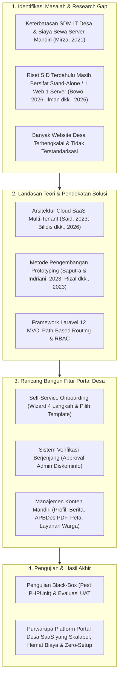

# Tugas 4 - Penyusunan Kajian Pustaka

**Mata Kuliah**: Metodologi Penelitian  
**SKS**: 3  
**Prodi**: Sarjana Terapan Manajemen Informatika  
**Angkatan**: 2024  

**Nama**: Fahrel Ilham Jaya Kusuma  
**NIM**: 24091397024  
**Kelas**: 2024A  

---

## A. Topik (Judul Sementara)
**Rancang Bangun Platform Portal Desa Berbasis *Software as a Service* (SaaS) Menggunakan Metode Prototyping (Studi Kasus: Diskominfo Provinsi Jawa Timur)**

---

## B. Penelitian Terdahulu (Subbab 2.1)

Penelitian terdahulu digunakan sebagai tolok ukur ilmiah untuk memetakan perkembangan riset di bidang Sistem Informasi Desa (SID), penerapan arsitektur komputasi awan (*Software as a Service*), serta penggunaan metode *prototyping* dan *framework* Laravel. Berikut adalah komparasi 10 artikel ilmiah (5 artikel dari Tugas 1 dan 5 artikel baru terbitan 5 tahun terakhir yang dapat diakses secara terbuka) yang relevan dengan penelitian ini:

### Tabel 2.1 Penelitian Terdahulu

| No | Judul | Peneliti, Media Publikasi dan Tahun | Tujuan Penelitian | Hasil Penelitian | Research Gap |
|:---|:---|:---|:---|:---|:---|
| 1. | Challenges for Public Sector Organisations in Cloud Adoption: A Case Study of South Australian Public Sector Agency | Mirza, Y., *International Journal of Managing Public Sector Information and Communication Technologies (IJMPICT)*, Vol. 12(3/4), 2021 | Mengidentifikasi faktor penghambat dan tantangan teknis maupun organisasional yang dihadapi instansi pemerintah lokal dalam mengadopsi teknologi *cloud* dan SaaS. | Hambatan utama sektor publik dalam adopsi *cloud* meliputi kekhawatiran keamanan data, privasi, kurangnya keahlian IT internal di tingkat daerah, serta kompleksitas integrasi sistem lama. | Penelitian berfokus pada pemetaan hambatan manajerial di Australia Selatan, namun belum merancang purwarupa aplikasi SaaS *self-service* yang mengatasi keterbatasan SDM IT di unit pemerintahan terkecil (desa). |
| 2. | Cloud-Based Government Services: Enhancing Public Sector Operations | Said, R., *OSF Preprints*, 2023 | Mengkaji peran layanan berbasis *cloud computing* (termasuk model SaaS) dalam meningkatkan efisiensi operasional dan pelayanan publik pada sektor pemerintahan. | Layanan berbasis *cloud* terbukti mempercepat distribusi layanan pemerintah daerah, memangkas hambatan birokrasi, serta menekan biaya pengadaan dan pemeliharaan infrastruktur perangkat keras. | Kajian masih bersifat konseptual dan makro pada sektor publik umum, belum menyentuh implementasi teknis arsitektur *multi-tenant* untuk pengelolaan portal informasi dan administrasi desa. |
| 3. | Efektivitas Sistem Informasi Desa dalam Meningkatkan Keterbukaan Informasi Publik di Desa Larangan | Nur, R. M., & Rodiyah, I., *Sawala: Jurnal Administrasi Negara*, Vol. 13(1), 2025 | Menganalisis efektivitas penerapan Sistem Informasi Desa (SID) terhadap peningkatan transparansi dan keterbukaan informasi publik bagi masyarakat desa. | Penerapan website desa terbukti efektif meningkatkan transparansi pengelolaan anggaran (APBDes), publikasi berita kegiatan, dan kemudahan akses informasi secara *real-time* bagi warga. | Sistem hanya dievaluasi pada satu desa secara terpisah (*stand-alone*) dan belum membahas bagaimana pemerintah daerah dapat menyediakan platform terpusat bagi banyak desa sekaligus. |
| 4. | Sistem Informasi Dokumen Proposal Pembangunan Desa Berbasis Website Pada Kantor Kepala Desa Reungkam | Muhammad, H., *Jurnal Sistem Informasi dan Teknologi (JSIMTEK)*, Vol. 3(2), 2025 | Merancang dan membangun aplikasi web untuk mendigitalisasi pengelolaan arsip dokumen dan pengajuan proposal pembangunan di Kantor Kepala Desa Reungkam. | Menghasilkan sistem berbasis web yang mempermudah perangkat desa dalam pengarsipan dokumen pembangunan dan memangkas waktu pencarian berkas fisik di kantor desa. | Aplikasi dibangun secara monolitik khusus untuk satu kantor desa menggunakan metode *Waterfall*, sehingga tidak memiliki fitur *multi-tenancy* untuk digunakan bersama oleh desa lain tanpa instalasi ulang. |
| 5. | Pemanfaatan Sistem Informasi Desa (SID) terhadap Peningkatan Pelayanan Publik di Desa Penyampak dan Desa Tebing | Doni, D., & Saimi, S., *Jurnal Ilmu Siber dan Informatika Digital (JUISIK)*, Vol. 6(2), 2026 | Mengevaluasi dampak pemanfaatan aplikasi Sistem Informasi Desa terhadap kualitas dan kecepatan pelayanan administrasi publik pada dua desa. | Pemanfaatan SID secara signifikan mempercepat proses pengurusan surat-menyurat warga dan meningkatkan indeks kepuasan masyarakat terhadap kinerja aparatur desa. | Sistem pada kedua desa masih dikelola secara terpisah di masing-masing desa dan belum terintegrasi dalam satu ekosistem SaaS terpusat yang diawasi oleh dinas komunikasi tingkat daerah. |
| 6. | Rancang Bangun Sistem Informasi Pelayanan Administrasi Desa Berbasis Website Menggunakan Metode Prototype di Desa Ciomas Kabupaten Ciamis | Saputra, F. S., & Indriani, *Computatio: Journal of Computer Science and Information Systems*, Vol. 7(2), 2023 | Membangun sistem informasi pelayanan administrasi desa berbasis web menggunakan metode *Prototype* untuk mengatasi keterlambatan pengisian formulir fisik di Desa Ciomas. | Metode *Prototype* berhasil melibatkan partisipasi aktif perangkat desa dalam perancangan fitur pengajuan layanan daring, verifikasi berkas, pelacakan status surat, dan unduh dokumen dengan hasil pengujian *black-box* yang valid. |Meskipun telah menerapkan metode *Prototype* dengan baik, arsitektur sistem yang dibangun masih *single-tenant* (khusus Desa Ciomas) dan belum menyediakan mekanisme pendaftaran desa mandiri (*onboarding wizard*). |
| 7. | Rancang Bangun Sistem Informasi Desa (SID) Untuk Meningkatkan Pelayanan Publik Desa Sei Limbat | Rizal, C., Zen, M., Hendry, & Nasution, A. F., *Jurnal Komputer Teknologi Informasi Sistem Komputer (JUKTISI)*, Vol. 2(2), 2023 | Merancang Sistem Informasi Desa berbasis web dengan metode *Prototype* yang mencakup modul administrasi, pelayanan publik, informasi desa, dan keuangan desa di Desa Sei Limbat. | Menghasilkan rancangan dan purwarupa SID terpadu yang meningkatkan transparansi anggaran serta efisiensi waktu dan biaya pelayanan warga di Desa Sei Limbat. | Sistem dirancang untuk kebutuhan spesifik satu desa tanpa dukungan pilihan *template* antarmuka dinamis maupun manajemen *multi-tenant* untuk skala kabupaten atau provinsi. |
| 8. | Sistem Informasi Pelayanan Desa Berbasis Website dengan Framework Laravel (Studi Kasus: Desa Penggarutan Kecamatan Bumiayu) | Ilman, M. Z., Mukrodin, & Pramana, D. A., *Jurnal Sistem Informasi dan Teknologi Peradaban (JSITP)*, Vol. 6(2), 2025 | Mengembangkan sistem pelayanan administrasi desa berbasis web menggunakan *framework* Laravel untuk mengatasi antrean dan keterlambatan layanan manual di Desa Penggarutan. | Implementasi *framework* Laravel berhasil menyediakan fitur pengajuan surat daring dan verifikasi admin desa yang terstruktur, dengan hasil pengujian *black-box* dan penerimaan pengguna yang tinggi. | Penggunaan *framework* Laravel masih diterapkan untuk satu instansi desa tunggal, belum memanfaatkan kapabilitas *routing* dan *middleware* Laravel untuk isolasi data banyak desa (*multi-tenancy*). |
| 9. | Rancang Bangun Sistem Informasi Desa Menggunakan Framework Laravel 12 | Bowo, H. T., *Jurnal Inovasi Komputer (INOKOM)*, Vol. 2(1), 2026 | Merancang dan mengembangkan sistem informasi desa berbasis web menggunakan *framework* Laravel 12 dan arsitektur MVC untuk mendukung layanan surat, berita, dan data penduduk. | Sistem berbasis Laravel 12 terbukti modular, aman, dan mampu mempercepat akses informasi publik serta layanan pengajuan surat dengan manajemen hak akses pengguna dan admin desa. | Penelitian ini menggunakan metode *Waterfall* yang kurang fleksibel terhadap perubahan antarmuka, serta masih berfokus pada pengelolaan satu desa tanpa fitur SaaS dan persetujuan berjenjang dari Diskominfo. |
| 10. | Perancangan Aplikasi Event Organizer Berbasis Web dengan Implementasi Model Software as a Service (SaaS) | Billqis, W. P., Oktaviani, D., & Nugraha, Y., *Adopsi Teknologi dan Sistem Informasi (ATASI)*, Vol. 5(2), 2026 | Merancang aplikasi manajemen berbasis web dengan model *Software as a Service* (SaaS) dan arsitektur *multi-tenant* agar dapat digunakan oleh banyak organisasi secara bersamaan. | Penerapan model SaaS *multi-tenant* dengan pendekatan iteratif/prototyping terbukti mampu menjaga isolasi data antar-organisasi (*tenant*) dalam satu sistem terpusat dan lolos uji fungsional *Black-Box Testing*. | Arsitektur SaaS *multi-tenant* diterapkan pada sektor komersial (*Event Organizer*), sehingga belum mengakomodasi alur birokrasi pemerintahan seperti verifikasi instansi (Diskominfo), transparansi APBDes, dan layanan warga desa. |

---

### Sintesis Penelitian Terdahulu

Berdasarkan pemetaan pada Tabel 2.1 di atas, dapat disusun sintesis kritis terhadap kesepuluh penelitian terdahulu melalui lima aspek utama berikut:

1. **Persamaan Penelitian:**
   Kesepuluh penelitian di atas memiliki benang merah yang sama dalam hal pemanfaatan teknologi informasi berbasis web untuk mendigitalisasi proses bisnis organisasi, meningkatkan efisiensi layanan administrasi, serta memperkuat transparansi informasi kepada publik. Secara spesifik, penelitian Nur & Rodiyah (2025), Muhammad (2025), Doni & Saimi (2026), Saputra & Indriani (2023), Rizal dkk. (2023), Ilman dkk. (2025), serta Bowo (2026) memiliki kesamaan objek penelitian dengan penelitian yang diusulkan, yaitu pengelolaan informasi profil desa, publikasi berita/anggaran desa, dan pelayanan administrasi persuratan warga. Dari sisi teknologi dan metode pengujian, beberapa penelitian terbaru (Ilman dkk., 2025; Bowo, 2026; Billqis dkk., 2026) juga menggunakan arsitektur *Model-View-Controller* (MVC) pada *framework* Laravel serta mengandalkan metode *Black-Box Testing* dan evaluasi pengguna untuk memvalidasi kelayakan fungsional sistem.

2. **Perbedaan Penelitian:**
   Perbedaan mendasar terletak pada **pendekatan arsitektur perangkat lunak**, **metode pengembangan sistem (SDLC)**, dan **cakupan tata kelola penggunanya**. Penelitian mengenai Sistem Informasi Desa yang dilakukan oleh Muhammad (2025), Saputra & Indriani (2023), Rizal dkk. (2023), Ilman dkk. (2025), dan Bowo (2026) seluruhnya menggunakan arsitektur *single-tenant* (*stand-alone*), di mana satu kode sumber dan satu basis data hanya dibangun untuk melayani satu desa tertentu. Sebaliknya, penelitian Mirza (2021) dan Said (2023) mengkaji model *cloud computing* dan SaaS di sektor pemerintah secara makro tanpa membangun purwarupa teknis, sedangkan Billqis dkk. (2026) membangun aplikasi SaaS *multi-tenant* namun ditujukan untuk sektor bisnis komersial (*Event Organizer*). Dari sisi metode pengembangan, Muhammad (2025) dan Bowo (2026) menerapkan metode sekuensial *Waterfall*, sementara Saputra & Indriani (2023) serta Rizal dkk. (2023) menerapkan metode *Prototyping*.

3. **Kelebihan dan Keterbatasan Penelitian Terdahulu:**
   * **Kelebihan:** Penelitian terdahulu di tingkat desa (Saputra & Indriani, 2023; Rizal dkk., 2023; Bowo, 2026) telah berhasil merumuskan modul-modul esensial yang benar-benar dibutuhkan oleh pemerintah desa, seperti manajemen perangkat desa, berita, transparansi APBDes, dan alur pengajuan surat warga. Di sisi lain, penelitian Billqis dkk. (2026) dan Said (2023) berhasil membuktikan bahwa arsitektur SaaS *multi-tenant* mampu mengisolasi data antar-organisasi dalam satu basis data terpusat sekaligus menekan biaya pemeliharaan server.
   * **Keterbatasan:** Keterbatasan paling krusial pada penelitian SID terdahulu adalah ketergantungan pada model instalasi mandiri (*stand-alone*) per desa. Sebagaimana diungkapkan oleh Mirza (2021), instansi pemerintah lokal memiliki keterbatasan staf IT dan anggaran server. Jika model *stand-alone* pada penelitian Ilman dkk. (2025) atau Bowo (2026) diterapkan pada ratusan desa di satu provinsi, akan terjadi pemborosan biaya *hosting* dan kesulitan pemeliharaan teknis yang berujung pada terbengkalainya website desa.

4. **Research Gap (Celah Penelitian):**
   Dari sintesis di atas, teridentifikasi celah penelitian (*research gap*) yang jelas: **belum adanya penelitian terapan yang mengintegrasikan arsitektur *Software as a Service* (SaaS) *multi-tenant* ke dalam pengembangan Sistem Informasi dan Layanan Administrasi Desa yang dilengkapi mekanisme pendaftaran mandiri (*self-service onboarding wizard*) serta alur verifikasi berjenjang oleh dinas tingkat provinsi (Diskominfo)**. Penelitian SID yang ada masih bersifat monolitik per desa, sedangkan penelitian SaaS di sektor publik masih bersifat konseptual atau belum menyediakan fitur *zero-code website builder* khusus untuk aparatur desa.

5. **Posisi Penelitian yang Dilakukan:**
   Penelitian ini hadir untuk menjembatani celah tersebut dengan merancang dan membangun purwarupa **Platform Portal Desa Berbasis SaaS Menggunakan Metode Prototyping pada Studi Kasus Diskominfo Provinsi Jawa Timur**. Kontribusi dan pembaruan (*novelty*) penelitian ini meliputi: (a) penerapan arsitektur *multi-tenancy* berbasis *path-based routing* (`/desa/{slug}`) menggunakan *framework* Laravel 12 sehingga satu platform dapat melayani banyak desa sekaligus tanpa instalasi server berulang; (b) penyediaan fitur *wizard* pendaftaran 4 langkah dan pilihan *template* tampilan (Klasik dan Modern) agar perangkat desa dapat menerbitkan website secara mandiri tanpa keahlian koding; serta (c) integrasi fitur *approval workflow* dan *monitoring* bagi Admin Provinsi (Diskominfo) untuk menjamin validitas portal desa sebelum ditayangkan ke publik.

---

## C. Landasan Teori (Subbab 2.2)

### 2.2.1 Konsep/Teori Utama: *Software as a Service* (SaaS) dan Arsitektur *Multi-Tenancy* pada *E-Government*

*Software as a Service* (SaaS) merupakan salah satu model layanan utama dalam komputasi awan (*cloud computing*) di mana perangkat lunak aplikasi disediakan dan dikelola secara terpusat oleh penyedia layanan, sehingga pengguna dapat mengaksesnya langsung melalui peramban web (*web browser*) tanpa perlu menginstal atau memelihara infrastruktur server secara mandiri (Said, 2023). Dalam konteks *electronic government* (*e-government*), adopsi model SaaS menggeser paradigma pengadaan teknologi informasi dari yang semula berbasis belanja modal perangkat keras (*on-premise*) di setiap instansi menjadi layanan berbagi pakai yang terstandarisasi dan efisien (Mirza, 2021).

Komponen fundamental yang menjadi tulang punggung efisiensi pada platform SaaS adalah arsitektur ***Multi-Tenancy***. Menurut Billqis dkk. (2026), *multi-tenancy* adalah prinsip arsitektur perangkat lunak di mana satu instansi aplikasi (*single application instance*) yang berjalan pada satu server mampu melayani banyak organisasi atau kelompok pengguna (*tenant*) secara simultan. Setiap *tenant* (dalam penelitian ini adalah masing-masing pemerintah desa) berbagi kode sumber dan infrastruktur yang sama, namun data, konfigurasi profil, dan hak akses pengguna antar-desa tetap terisolasi secara ketat secara logis.

Secara teknis, terdapat tiga pendekatan utama dalam pengelolaan basis data *multi-tenant*, yaitu: (1) *Separate Database* (satu aplikasi dengan basis data terpisah untuk tiap *tenant*), (2) *Shared Database, Separate Schema*, dan (3) *Shared Database, Shared Schema* (satu basis data dan tabel yang sama dengan pembeda kolom identitas *tenant*, seperti `village_id`). Dalam pengembangan platform Portal Desa skala pemerintah daerah, pendekatan *Shared Database, Shared Schema* yang dipadukan dengan mekanisme ***Path-Based Routing*** (`/desa/{slug}`) menjadi pilihan yang sangat optimal. Dibandingkan dengan model *stand-alone* yang diterapkan oleh Muhammad (2025) dan Suli & Nirsal (2023), pendekatan *multi-tenant* berbasis *path routing* ini tidak memerlukan konfigurasi *subdomain* atau DNS baru setiap kali ada desa yang mendaftar, sehingga pembaruan fitur dan pemeliharaan keamanan dapat dilakukan satu kali secara terpusat oleh pengelola provinsi.

### 2.2.2 Konsep/Variabel/Objek yang Diteliti: Portal Desa dan Sistem Informasi Layanan Administrasi Desa

Objek utama yang diteliti dan dikembangkan dalam penelitian ini adalah **Portal Desa**, yaitu sistem informasi berbasis web yang berfungsi sebagai gerbang informasi publik sekaligus sarana pelayanan administrasi terpadu di tingkat pemerintahan desa. Mengacu pada amanat Undang-Undang Nomor 6 Tahun 2014 tentang Desa, pemerintah desa berkewajiban menyelenggarakan sistem informasi desa yang terbuka dan akuntabel bagi masyarakat. Penelitian Doni & Saimi (2026) serta Nur & Rodiyah (2025) menegaskan bahwa keberadaan Sistem Informasi Desa (SID) yang efektif diukur dari dua dimensi utama, yaitu **keterbukaan informasi publik** dan **efisiensi pelayanan administrasi warga**.

Dalam rancangan platform Portal Desa pada penelitian ini, karakteristik dan dimensi objek yang diteliti mencakup empat komponen terintegrasi:
1. ***Self-Service Onboarding* (Pendaftaran Mandiri Perangkat Desa):** Mekanisme yang memungkinkan perwakilan desa mendaftarkan desanya secara mandiri melalui formulir bertahap (*multi-step wizard*) yang mencakup pengisian data dasar desa, pemilihan *template* visual (Klasik atau Modern), pengunggahan aset media (logo dan foto *hero*), serta pengisian struktur perangkat desa.
2. **Tata Kelola Verifikasi Berjenjang (*Admin Approval Workflow*):** Berbeda dengan website desa *stand-alone* yang langsung aktif tanpa pengawasan, platform SaaS pemerintahan memerlukan kendali mutu dari instansi pembina, yakni Dinas Komunikasi dan Informatika (Diskominfo) Provinsi. Setiap pengajuan portal desa baru akan berstatus *pending review* dan harus diverifikasi (*approve* atau *reject* disertai alasan revisi) oleh Admin Provinsi sebelum berstatus *published* dan dapat diakses publik.
3. **Manajemen Konten Publikasi Desa dan Transparansi APBDes:** Setelah disetujui pada penerbitan pertama, perangkat desa memiliki otonomi penuh untuk memperbarui konten desanya secara *real-time* tanpa perlu persetujuan ulang. Modul ini meliputi publikasi artikel berita desa, galeri kegiatan, pemetaan titik lokasi penting berbasis koordinat peta interaktif, serta publikasi laporan transparansi Anggaran Pendapatan dan Belanja Desa (APBDes) yang dapat diekspor ke dalam dokumen PDF (Rizal dkk., 2023).
4. **Layanan Administrasi Warga Daring:** Menyediakan direktori informasi persyaratan layanan publik serta memfasilitasi warga terdaftar untuk mengajukan permohonan surat administrasi secara daring beserta dokumen pendukungnya untuk diproses oleh operator desa (Saputra & Indriani, 2023).

### 2.2.3 Metode/Algoritma/Teknologi yang Digunakan

#### 1. Metode Pengembangan Perangkat Lunak: Metode *Prototyping*
Penelitian ini menerapkan **Metode *Prototyping*** sebagai kerangka kerja *Software Development Life Cycle* (SDLC). Metode *Prototyping* adalah pendekatan rekayasa perangkat lunak iteratif yang berfokus pada penerjemahan kebutuhan pengguna ke dalam bentuk model kerja awal (*working prototype*) secara cepat agar dapat dievaluasi langsung oleh calon pengguna (Saputra & Indriani, 2023; Rizal dkk., 2023). Pemilihan metode ini didasarkan pada pertimbangan bahwa pengguna utama Portal Desa adalah aparatur desa yang memiliki latar belakang kemampuan teknis beragam, sehingga mereka cenderung lebih mudah memberikan masukan ketika melihat dan mencoba langsung antarmuka aplikasi dibandingkan hanya membaca dokumen spesifikasi teknis yang abstrak.

Tahapan metode *Prototyping* yang diterapkan dalam penelitian ini meliputi lima langkah sistematis:
1. **Pengumpulan dan Analisis Kebutuhan (*Communication & Requirement Gathering*):** Mengidentifikasi kebutuhan fungsional dan aturan bisnis dari ketiga aktor sistem (Admin Provinsi Diskominfo, Perwakilan Desa, dan Warga Layanan), termasuk alur *wizard* pendaftaran dan isolasi hak akses.
2. **Perancangan Cepat (*Quick Design*):** Menyusun rancangan arsitektur sistem menggunakan pemodelan *Unified Modeling Language* (UML), merancang skema basis data relasional *multi-tenant* (*Entity Relationship Diagram*), serta membuat rancangan antarmuka (*wireframe*) untuk *wizard*, *dashboard*, dan dua pilihan *template* desa.
3. **Pembentukan Purwarupa (*Construction of Prototype*):** Menerjemahkan rancangan ke dalam kode program yang berfungsi penuh menggunakan *framework* Laravel, termasuk layanan *slug generator* otomatis dan manajemen sesi pendaftaran.
4. **Evaluasi dan Pengujian Pengguna (*User Evaluation & Testing*):** Menguji fungsionalitas prototipe dan mendemonstrasikan alur kerja sistem kepada pengguna untuk mengumpulkan umpan balik terkait kemudahan penggunaan dan kesesuaian alur birokrasi.
5. **Penyempurnaan Purwarupa (*Refinement*):** Melakukan perbaikan kode, validasi formulir, dan penyempurnaan antarmuka berdasarkan temuan evaluasi hingga menghasilkan purwarupa akhir yang siap digunakan.

#### 2. Teknologi Pengembangan Sistem (*Tech Stack*)
Untuk mendukung arsitektur SaaS *multi-tenant* yang andal, penelitian ini menggunakan kombinasi teknologi web modern:
* ***Framework* Laravel 12 (PHP 8.2+):** Laravel adalah *framework* pengembangan aplikasi web berbasis bahasa PHP yang menerapkan pola arsitektur *Model-View-Controller* (MVC) untuk memisahkan logika bisnis (*Model/Service*), pengendali alur permintaan (*Controller*), dan tampilan antarmuka (*View*) (Bowo, 2026; Ilman dkk., 2025). Dalam penelitian ini, fitur *Middleware* pada Laravel dimanfaatkan untuk memvalidasi peran pengguna (*Role-Based Access Control*), *Eloquent ORM* digunakan untuk memastikan kueri data selalu terfilter berdasarkan identitas desa (`village_id`), dan *Blade Templating Engine* digunakan untuk merender tampilan desa secara dinamis sesuai *template* yang dipilih (*Klasik* atau *Modern*).
* **Basis Data Relasional MySQL 8.0:** Digunakan untuk menyimpan seluruh entitas data secara terpusat dan terhubung secara relasional melalui kunci asing (*foreign key*), mulai dari tabel `users`, `villages`, `templates`, `village_news`, `anggarans`, hingga `pengajuan_layanans` (Suli & Nirsal, 2023).
* **Tailwind CSS dan Alpine.js:** Tailwind CSS digunakan sebagai *utility-first CSS framework* untuk membangun antarmuka yang responsif di berbagai ukuran layar, sedangkan Alpine.js digunakan untuk menangani interaksi antarmuka secara reaktif dan ringan pada sisi klien (*client-side*).

#### 3. Metode Pengujian Sistem
Verifikasi dan validasi kualitas purwarupa dilakukan melalui dua pendekatan pengujian:
* ***Black-Box Testing* (Pengujian Fungsional Otomatis dan Manual):** Metode pengujian perangkat lunak yang berfokus pada pemeriksaan kesesuaian antara masukan (*input*) dan keluaran (*output*) fungsi sistem berdasarkan spesifikasi kebutuhan tanpa melihat struktur kode internal (Saputra & Indriani, 2023; Billqis dkk., 2026). Dalam penelitian ini, pengujian *black-box* juga didukung oleh pengujian otomatis menggunakan kerangka kerja **Pest (PHPUnit)** untuk memastikan fitur kritis seperti penanganan benturan nama URL desa (*slug collision handling*), pembatasan akses lintas-desa (*cross-tenant authorization*), dan alur *approve/reject* berjalan bebas dari kesalahan (*bug*).
* ***User Acceptance Testing* (UAT):** Pengujian penerimaan pengguna yang dilakukan oleh perwakilan pengguna (Admin dan Perangkat Desa) untuk menilai apakah alur pembuatan website mandiri dan pengelolaan konten telah sesuai dengan kebutuhan operasional dan mudah dioperasikan.

### 2.2.4 Konsep Pendukung dan Hubungan Antar-Konsep

Selain teori utama di atas, keberhasilan implementasi platform Portal Desa berbasis SaaS juga ditopang oleh tiga konsep pendukung teknis:
1. ***Role-Based Access Control* (RBAC) dan Otorisasi Lintas-Desa:** Pengaturan hak akses ketat yang membagi pengguna ke dalam tiga peran terpisah (`admin_provinsi`, `perwakilan_desa`, dan `warga_layanan`) beserta pengunjung publik. Konsep ini memastikan bahwa akun perwakilan dari satu desa tidak dapat memodifikasi atau melihat data dapur milik desa lainnya.
2. ***Session-Based Multi-Step Wizard*:** Teknik penyimpanan data sementara pada memori sesi (*session*) selama perwakilan desa mengisi langkah 1 hingga langkah 4 pada *wizard* pendaftaran. Data baru disimpan permanen (*commit*) ke dalam basis data MySQL ketika pengguna menekan tombol kirim pada tahap tinjauan akhir (*review*), sehingga mencegah penumpukan data sampah (*incomplete draft*) di basis data.
3. ***Automated Slug Generation & Collision Handling*:** Mekanisme pembuatan identitas URL ramah mesin pencari (*search engine friendly*) secara otomatis dari nama desa (misalnya "Desa Sumberan" menjadi `/desa/sumberan`). Jika terdapat nama desa yang sama di kecamatan atau kabupaten berbeda, layanan sistem secara cerdas menambahkan penomoran unik (`/desa/sumberan-2`) agar tidak terjadi kegagalan sistem.

#### Hubungan Antar-Konsep dan Kerangka Berpikir
Secara logis, seluruh konsep dalam penelitian ini saling terhubung membentuk satu kesatuan solusi: permasalahan keterbatasan SDM IT desa dan tingginya biaya server pada model website *stand-alone* (**Masalah**) dipecahkan melalui penerapan arsitektur **SaaS *Multi-Tenant*** yang terpusat di bawah pengawasan Diskominfo (**Teori Utama**). Agar platform SaaS ini mudah diadopsi oleh aparatur desa yang non-teknis, proses pengembangannya dilakukan secara iteratif menggunakan **Metode *Prototyping*** yang dipadukan dengan fitur ***Self-Service Wizard*** dan *framework* **Laravel 12** (**Metode & Teknologi**), kemudian divalidasi melalui ***Black-Box Testing* dan UAT** hingga menghasilkan **Portal Desa Terintegrasi** (**Solusi Akhir**).

Hubungan konseptual tersebut divisualisasikan dalam bagan Kerangka Berpikir pada gambar berikut:

---

## D. Daftar Pustaka

Seluruh sumber referensi di bawah ini diterbitkan dalam 5 tahun terakhir (2021-2026), disusun menggunakan gaya sitasi **APA 7th Edition**, serta dilengkapi dengan tautan DOI dan URL resmi yang aktif dan dapat diakses:

Billqis, W. P., Oktaviani, D., & Nugraha, Y. (2026). Perancangan aplikasi Event Organizer berbasis web dengan implementasi model Software as a Service (SaaS). *Adopsi Teknologi dan Sistem Informasi (ATASI)*, *5*(2), 86-94. https://doi.org/10.30872/atasi.v5i2.4610

Bowo, H. T. (2026). Rancang bangun sistem informasi desa menggunakan framework Laravel 12. *Jurnal Inovasi Komputer (INOKOM)*, *2*(1), 22-33. https://doi.org/10.71200/dmqt7z58

Doni, D., & Saimi, S. (2026). Pemanfaatan Sistem Informasi Desa (SID) terhadap peningkatan pelayanan publik di Desa Penyampak dan Desa Tebing. *Jurnal Ilmu Siber dan Informatika Digital (JUISIK)*, *6*(2). https://doi.org/10.55606/juisik.v6i2.2434

Ilman, M. Z., Mukrodin, & Pramana, D. A. (2025). Sistem informasi pelayanan desa berbasis website dengan framework Laravel (Studi kasus: Desa Penggarutan Kecamatan Bumiayu). *Jurnal Sistem Informasi dan Teknologi Peradaban (JSITP)*, *6*(2). https://doi.org/10.58436/jsitp.v6i2.2356

Mirza, Y. (2021). Challenges for public sector organisations in cloud adoption: A case study of South Australian public sector agency. *International Journal of Managing Public Sector Information and Communication Technologies (IJMPICT)*, *12*(3/4), 1-15. https://doi.org/10.5121/ijmpict.2021.12301

Muhammad, H. (2025). Sistem informasi dokumen proposal pembangunan desa berbasis website pada Kantor Kepala Desa Reungkam. *Jurnal Sistem Informasi dan Teknologi (JSIMTEK)*, *3*(2), 154-162. https://doi.org/10.33020/jsimtek.v3i2.896

Nur, R. M., & Rodiyah, I. (2025). Efektivitas Sistem Informasi Desa dalam meningkatkan keterbukaan informasi publik di Desa Larangan. *Sawala: Jurnal Administrasi Negara*, *13*(1), 91-98. https://doi.org/10.30656/sawala.v13.i1.9800

Rizal, C., Zen, M., Hendry, & Nasution, A. F. (2023). Rancang bangun Sistem Informasi Desa (SID) untuk meningkatkan pelayanan publik Desa Sei Limbat. *Jurnal Komputer Teknologi Informasi Sistem Komputer (JUKTISI)*, *2*(2), 433-438. https://doi.org/10.62712/juktisi.v2i2.134

Said, R. (2023). *Cloud-based government services: Enhancing public sector operations*. OSF Preprints. https://doi.org/10.31219/osf.io/8yrfp

Saputra, F. S., & Indriani. (2023). Rancang bangun sistem informasi pelayanan administrasi desa berbasis website menggunakan metode Prototype di Desa Ciomas Kabupaten Ciamis. *Computatio: Journal of Computer Science and Information Systems*, *7*(2), 197-204. https://doi.org/10.24912/computatio.v7i2.26429

Suli, K. T., & Nirsal, N. (2023). Rancang bangun sistem informasi desa berbasis website (Studi kasus Desa Walenrang). *D'computare: Jurnal Ilmiah Teknologi Informasi dan Ilmu Komputer*, *13*(1), 24-32. https://doi.org/10.30605/dcomputare.v13i1.57
